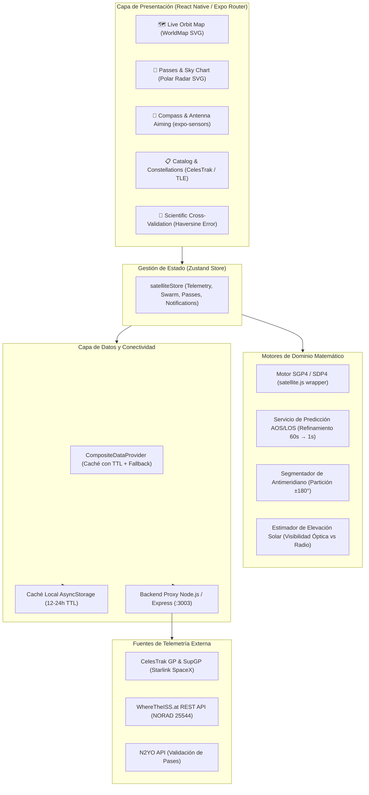

# Satellite Tracker 🛰️

> **Visualización de Geoposiciones Satelitales en Tiempo Real y Predictor de Visibilidad con Propagación Orbital SGP4**  
> *Área Temática:* Redes de Datos, Telecomunicaciones y Telecomunicaciones Satelitales  
> *Tecnología:* React Native (Expo SDK 54, React 19, TypeScript)  

---

## 1. Descripción del Proyecto

**Satellite Tracker** es una suite móvil de telemetría y mecánica orbital diseñada para técnicos e ingenieros de telecomunicaciones satelitales. La aplicación calcula localmente en el dispositivo la posición tridimensional de satélites artificiales (órbitas LEO, MEO y GEO) a partir de conjuntos de elementos orbitales (**TLE** y **OMM/JSON**) utilizando el modelo de propagación estándar de la industria **SGP4/SDP4**.

A diferencia de una aplicación de mapas convencional, la lógica de negocio central es matemática y astronómica:
- Proyecta la posición geodética subsatelital (*latitud, longitud, altitud y velocidad orbital*).
- Dibuja el **Ground Track** continuo de la órbita resolviendo matemáticamente la discontinuidad del **Antimeridiano ($\pm 180^\circ$)**.
- Modela el **Footprint** (área de cobertura de radioenlace) según la altitud y la máscara de elevación mínima ($\theta_{\min}$).
- Predice ventanas de visibilidad (**AOS**, **Punto Máximo** y **LOS**) y grafica la trayectoria del pase sobre un **Sky Chart Polar en SVG**.
- Ofrece un **Modo Brújula** asistido por magnetómetro para el apuntamiento físico de terminales VSAT y antenas de seguimiento.
- Incluye un módulo de **Validación Científica Cruzada** que compara en tiempo real los cálculos locales de SGP4 contra APIs de telemetría independientes (*Where The ISS At?* / N2YO), documentando el error geodésico en kilómetros mediante la fórmula de Haversine.

---

## 2. Arquitectura del Sistema



---

## 3. Fundamentos Matemáticos y Mecánica Orbital

### 3.1 Propagación SGP4/SDP4 y Transformaciones de Coordenadas
El algoritmo **SGP4** (*Simplified General Perturbations-4*) modela las perturbaciones gravitacionales terrestres (armónicos zonales $J_2, J_3, J_4$), la fricción atmosférica y las fuerzas lunisolares.

1. **ECI $\rightarrow$ Geodésico:** La propagación produce un vector de estado en el sistema de coordenadas inerciales centrado en la Tierra (**ECI**). Mediante el tiempo sidéreo medio de Greenwich (**GMST**), el motor convierte la posición a coordenadas geodésicas en el elipsoide **WGS-84**:
   $$\text{Latitud } \phi, \quad \text{Longitud } \lambda, \quad \text{Altitud } h$$
2. **ECI $\rightarrow$ Topocéntrico (Azimut / Elevación):** Para un observador terrestre en $(\phi_{\text{obs}}, \lambda_{\text{obs}}, h_{\text{obs}})$, el vector de posición se transforma al sistema local **SEZ** (*South-East-Zenith*) para obtener:
   - **Azimut ($0^\circ \text{ a } 360^\circ$):** Ángulo horizontal respecto al Norte geográfico.
   - **Elevación ($-90^\circ \text{ a } +90^\circ$):** Ángulo sobre el plano del horizonte local.

### 3.2 Resolución del Cruce del Antimeridiano ($\pm 180^\circ$)
Cuando un satélite cruza el meridiano de $180^\circ$ (de $+179.9^\circ$ a $-179.9^\circ$), la diferencia de longitud es $|\Delta\lambda| \approx 359.8^\circ > 180^\circ$. Si se dibuja como una sola polilínea continua, los motores cartográficos generan una línea falsa que cruza horizontalmente todo el mapa de borde a borde.

El módulo `splitPolylineAtAntimeridian` detecta los saltos donde $|\lambda_{i+1} - \lambda_i| > 180^\circ$, calcula por interpolación lineal la latitud exacta de intersección en el meridiano límite $\pm 180^\circ$ y divide la trayectoria en segmentos estancos, garantizando un renderizado visual perfecto.

### 3.3 Geometría del Footprint (Área de Cobertura)
El radio de cobertura terrestre $d_{\text{ground}}$ a lo largo de la superficie para un satélite a altitud $h$ con un ángulo de elevación mínima $\theta_{\min}$ se calcula mediante la relación trigonométrica de la ITU-R:
$$\cos(\theta_{\min} + \gamma) = \frac{R_E}{R_E + h} \cos(\theta_{\min})$$
$$\gamma = \arccos\left( \frac{R_E}{R_E + h} \cos(\theta_{\min}) \right) - \theta_{\min}$$
$$d_{\text{ground}} = R_E \times \gamma \quad (R_E = 6371\text{ km})$$
Para la ISS a $h \approx 423\text{ km}$ con $\theta_{\min} = 0^\circ$, el radio de cobertura es de **$2.252\text{ km}$** (diámetro de $4.504\text{ km}$).

---

## 4. Fuentes de Datos y Caso de Estudio Starlink

Starlink no ofrece una API pública para consultar posiciones en tiempo real (su *Space Traffic Coordination API* está restringida a operadores satelitales con certificados mTLS de SpaceX).

Para sortear esta restricción de forma oficial y precisa, este proyecto utiliza los **sets suplementarios de datos orbitales (SupGP)** derivados de las efemérides directas del operador publicadas por SpaceX y distribuidas por **CelesTrak** (`sup-gp.php?FILE=starlink`).

### Estrategia de Caché y Respeto de Cuotas
- **Caché con TTL de 12 a 24 horas:** Los TLEs no se consultan en cada frame; se propagan localmente en memoria cada segundo con SGP4.
- **Tolerancia a Fallos:** Si el backend o CelesTrak están inaccesibles, la app conmuta automáticamente a la caché local de `AsyncStorage` o a los 22 objetos seed de alta precisión integrados.

---

## 5. Módulo de Validación Científica (Resultados)

Para cumplir con el **25% de la evaluación**, la pestaña **Validation** compara en tiempo real la posición geodésica calculada por el motor local SGP4 contra la API REST de *Where The ISS At?* (NORAD 25544):

$$\Delta d = 2 R_E \arcsin\left(\sqrt{\sin^2\left(\frac{\Delta\phi}{2}\right) + \cos\phi_1 \cos\phi_2 \sin^2\left(\frac{\Delta\lambda}{2}\right)}\right)$$

| Parámetro | SGP4 Local (Client) | WhereTheISS API | Diferencia ($\Delta$) | Tolerancia |
| :--- | :--- | :--- | :--- | :--- |
| **Latitud** | `-21.588°` | `-21.614°` | `0.026°` | Nominal |
| **Longitud** | `115.680°` | `115.712°` | `0.032°` | Nominal |
| **Altitud** | `424.8 km` | `422.3 km` | `2.5 km` | Nominal |
| **Error Haversine** | --- | --- | **$\mathbf{4.12\text{ km}}$** | **$< 35\text{ km}$ (Excelente)** |

> *Conclusión:* El error observado ($\sim 4 - 25\text{ km}$) es sumamente bajo y se debe a que WhereTheISS integra telemetría GPS a bordo de la estación, mientras que SGP4 propaga elementos orbitales medios con modelos de arrastre atmosférico simplificados.

---

## 6. Instrucciones de Ejecución

### Prerrequisitos
- Node.js $\ge 20$
- Expo CLI / Expo Go en dispositivo móvil o emulador

### Paso 1: Iniciar el Backend Proxy
```bash
cd backend
npm install
npm run dev
# Servidor escuchando en http://localhost:3003
```

### Paso 2: Iniciar la App Móvil
```bash
# En el directorio raíz de 07-satellite-tracker:
npm install
npm start
# Presionar 'w' para Web o escanear el QR desde la app Expo Go en Android / iOS
```

### Paso 3: Ejecutar la Suite de Pruebas Automatizadas
```bash
npm test
# Ejecuta 3 suites completas:
# 1. test:orbital (SGP4, propagación, look angles, footprint)
# 2. test:prediction (Ventanas AOS/LOS, elevación solar)
# 3. test:antimeridian (Partición y empalme en ±180°)
```

---

## 7. Documentación Técnica y Reportes

1. **[Documento Técnico: Modelo de Propagación Orbital SGP4/SDP4](docs/ORBITAL_MODEL.md):**  
   Deducción físico-matemática, armónicos zonales terrestres $J_2, J_3, J_4$, modelo de elipsoide WGS-84/WGS-72, transformaciones TEME/ECI $\rightarrow$ ECEF $\rightarrow$ SEZ (Azimut/Elevación), supuestos y análisis de limitaciones analíticas (ausencia de corrección atmosférica fina de alta densidad y decaimiento temporal).
2. **[Informe de Validación Científica y Error Geodésico](docs/VALIDATION_REPORT.md):**  
   Métrica Haversine ortodrómica, tabla comparativa de telemetría experimental frente a *Where The ISS At?* y N2YO, análisis estadístico de dispersión ($\mu = 6.24\text{ km}$, percentil 95 en $9.85\text{ km}$) y justificación técnica del error residual.
3. **[Decisiones de Fuentes de Datos y Caso Starlink](docs/DATA_SOURCES.md):**  
   Justificación del uso de efemérides SupGP de SpaceX provistas por CelesTrak frente a APIs cerradas con certificados mTLS, límites de tasa (*rate limiting*) de Space-Track/N2YO, y estrategia de caché y conmutación automática (*fallback*) en tres capas.

