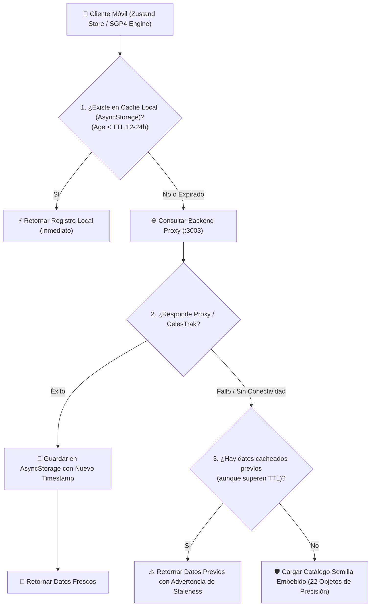

# Documento de Decisiones de Arquitectura: Fuentes de Datos, Caso Starlink y Estrategia de Caché

> **Proyecto:** Satellite Tracker  
> **Área:** Telecomunicaciones Satelitales y Arquitectura Móvil  

---

## 1. Justificación del Caso de Estudio: Constelación Starlink

### 1.1 Contexto y Restricciones de Acceso Oficial
La megaconstelación Starlink de SpaceX (compuesta por miles de satélites en órbita LEO a altitudes de $525 - 550\text{ km}$) representa el mayor despliegue de telecomunicaciones satelitales de banda ancha a nivel global. Sin embargo, no existe una API pública y abierta de telemetría en tiempo real:

1. **APIs Enterprise de Starlink:** Orientadas a la administración de cuentas comerciales, telemetría de terminales de usuario (Dishy), direccionamiento IP, routers y estado del backhaul. Requieren contratos corporativos y no exponen las trayectorias orbitales de los satélites.
2. **Space Traffic Coordination API (SpaceX):** Servicio reservado de manera estricta para operadores satelitales y agencias espaciales soberanas con el fin de coordinar maniobras de prevención de colisiones. Requiere **certificados mTLS cliente firmados por SpaceX**, acuerdos de confidencialidad (NDA) y no está abierta a aplicaciones móviles educativas o de consumo general.

### 1.2 Decisión Técnica: Sets Suplementarios SupGP de CelesTrak
Para permitir el seguimiento preciso del enjambre de satélites Starlink sin violar términos de servicio ni recurrir a ingeniería inversa frágil, se adoptó la fuente oficial estándar de la industria astronómica: **CelesTrak Supplemental GP Data (SupGP)** vía el endpoint:
`https://celestrak.org/NORAD/elements/supplemental/sup-gp.php?FILE=starlink&FORMAT=json`

**Ventajas de la solución elegida:**
- **Derivadas Directas del Operador:** A diferencia de los TLEs de radar que tardan horas en generarse, los datos SupGP son generados directamente por SpaceX a partir de las efemérides calculadas por sus propios centros de control y publicados en CelesTrak en formato estándar CCSDS OMM/JSON y TLE.
- **Identificación de 6 Dígitos:** La constelación Starlink ya supera los 6.000 satélites en órbita, excediendo el rango tradicional de 5 dígitos del formato TLE clásico (números NORAD $> 99.999$). CelesTrak distribuye identificadores Alpha-5 y registros OMM en JSON, soportados por la arquitectura de la app.

---

## 2. Inventario de Proveedores de Telemetría y Límites de Uso (Rate Limiting)

| Proveedor | Rol en el Sistema | Endpoint Principal | Autenticación | Límites de Uso (Rate Limits) | Política de Respeto |
| :--- | :--- | :--- | :--- | :--- | :--- |
| **CelesTrak** | Fuente primaria de catálogo orbital y Starlink SupGP | `celestrak.org/NORAD/elements/` | Pública (Sin API Key) | Sin límite formal estricto, pero sus fuentes se actualizan solo 1 a 2 veces al día | **TTL de 12 a 24 horas**. Nunca se consulta en renderizados de frame o ticks de segundo |
| **WhereTheISS.at** | Validación cruzada instantánea de la ISS (NORAD 25544) | `api.wheretheiss.at/v1/satellites/25544` | Pública (Sin API Key) | **1 request / segundo** (máximo 60 req/min) | Throttling local y llamadas manuales bajo demanda desde la pestaña Validation |
| **N2YO** | Validación secundaria y pases visuales / radio | `api.n2yo.com/rest/v1/satellite/` | API Key (HTTP Header / Query Param) | **1.000 transacciones/hora** (posiciones/TLE) y **100/hora** (predicciones) | Clave administrada en backend proxy para no exponerla en el bundle móvil |
| **Space-Track.org** | Fuente histórica y catálogo oficial US Space Force | `space-track.org/basicspacedata/query/` | Cookie de sesión / Identity + Password | **< 30 requests/minuto** y **< 300 requests/hora** | Reservada exclusivamente como fallback secundario en el proxy |

---

## 3. Arquitectura de Caché y Estrategia Fallback de Tres Capas

Para garantizar que la aplicación opere en modo **Offline-First**, permitiendo a técnicos en el campo predecir pases y apuntar antenas incluso en zonas rurales sin señal celular, se diseñó la interfaz desacoplada `DataProvider`:

### 3.1 Manejo de Antigüedad y Alerta de Desactualización (Staleness Alert)
Cada registro orbital almacena su `fetchedAt` y la época del TLE `epochDate`. La interfaz gráfica evalúa:
- **Óptimo ($< 24\text{ horas}$):** Indicador verde.
- **Aceptable ($24 - 72\text{ horas}$):** Indicador ámbar.
- **Desactualizado ($> 72\text{ horas}$):** Indicador rojo con notificación emergente alertando que el error de propagación en LEO puede superar los $30\text{ km}$.

---

## 4. Protección de Credenciales mediante Backend Proxy

Siguiendo las mejores prácticas de seguridad en desarrollo móvil:
- Las credenciales privadas (claves de N2YO y cuentas de Space-Track) **no están compiladas dentro del binario de React Native ni en el repositorio público**.
- El microservicio backend (`backend/src/server.ts` en Express/Node.js) actúa como guardián de credenciales, rate limiter centralizado y servidor de caché en memoria para múltiples clientes móviles concurrentes.

